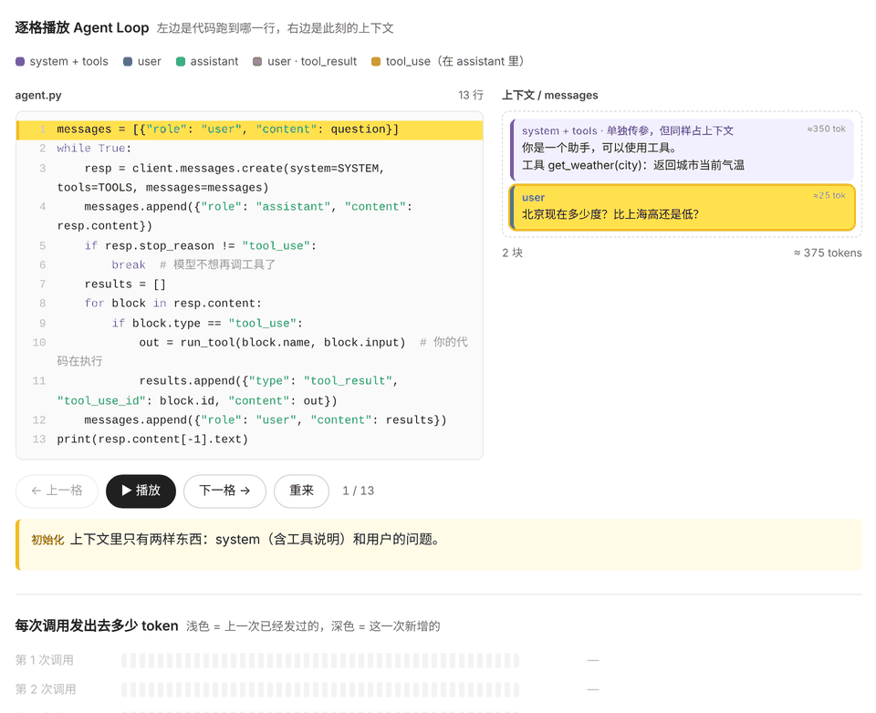

<div align="center">

# NamiAgent

**零基础入门 AI Agent 的基础教程**<br>
从零手写 Agent，一行行看懂 Claude Code、Codex 这类产品的内核

[](https://github.com/aa1143/NamiAgent/actions/workflows/test.yml)
[](https://www.python.org/)
[](LICENSE)
[](LICENSE-docs)
[](https://namiai.tech/agent/)
[](https://github.com/aa1143/NamiAgent/stargazers)
[](https://x.com/antiAIvo)

[图文教程](https://namiai.tech/agent/) · [快速开始](#快速开始) · [在线可视化](https://namiai.tech/matrix/agent/) · [作者 𝕏](https://x.com/antiAIvo)



<sub>Agent Loop 逐格播放：左边是代码跑到哪一行，右边是此刻的上下文</sub>

</div>

Agent 没有什么神秘的，核心就是一个 while 循环：调模型、执行工具、把结果写回上下文，再调模型。

这个仓库从 100 行的最小循环开始，一课加一个能力：工具、权限、上下文管理、Skills、MCP、子 Agent、计划、记忆。最后拆解 Claude Code、Codex 等主流 Agent 是怎么做的。内容是我自己一步步学习、动手实践后整理出来的。

- **每课一个可运行的快照**：`lessons/lesson-01` 到 `lesson-11`，每个目录都是学完这一课时的完整代码，可以直接运行，也可以对比相邻两课的差异
- **不绑定厂商**：使用 OpenAI 兼容接口，默认用 DeepSeek，换模型只需要改两个环境变量
- **测试不花钱**：第 3 课起每课都有测试，第 11 课共 49 个，用假模型跑，不需要 API Key
- **只依赖 `openai` 一个包**：没有任何 Agent 框架

> 先学 [NamiGPT](https://github.com/aa1143/NamiGPT) 搞懂模型本身，再学 NamiAgent 搞懂模型外面那一圈。

## 学之前，先看这份可视化

[Agent 是怎么工作的](https://namiai.tech/matrix/agent/)：10 章逐格播放，看上下文每转一圈怎么变长、在哪里出问题，以及各种 Agent 技巧到底在上下文里做了什么。上面那张动图就是其中第 3 章。

## 课程目录

### 第一部分：手写核心

| 课 | 文章 | 代码 | 这一课新增 |
|---|---|---|---|
| 01 | [最小循环](docs/01-minimal-loop.md) | [lesson-01](lessons/lesson-01/) | `agent.py`：三个工具 + 一个 while 循环 |
| 02 | [工具系统](docs/02-tools.md) | [lesson-02](lessons/lesson-02/) | `tools.py`：注册表、统一执行器 |
| 03 | [权限](docs/03-permissions.md) | [lesson-03](lessons/lesson-03/) | `permissions.py`：硬规则 → 风险分级 → 人工确认 |
| 04 | [上下文管理](docs/04-context.md) | [lesson-04](lessons/lesson-04/) | `context.py`：截断 → 清理 → 摘要，会话持久化 |
| 05 | [Skills](docs/05-skills.md) | [lesson-05](lessons/lesson-05/) | `skills.py`：AGENTS.md 常驻，技能按需加载 |
| 06 | [接入聊天软件](docs/06-chat-apps.md) | [lesson-06](lessons/lesson-06/) | `telegram.py`、`bot.py`：常驻、聊天确认、白名单 |
| 07 | [定时任务与心跳](docs/07-scheduler-heartbeat.md) | [lesson-07](lessons/lesson-07/) | `scheduler.py`：无人值守的预授权、心跳 |

### 第二部分：补上主流能力

| 课 | 文章 | 代码 | 这一课新增 |
|---|---|---|---|
| 08 | [MCP](docs/08-mcp.md) | [lesson-08](lessons/lesson-08/) | `mcp_client.py`：stdio MCP 客户端 |
| 09 | [子 Agent 与多 Agent](docs/09-subagents.md) | [lesson-09](lessons/lesson-09/) | `subagent.py`：独立上下文，并行只读 |
| 10 | [计划](docs/10-planning.md) | [lesson-10](lessons/lesson-10/) | `planning.py`：待办清单、由代码强制只读的计划模式 |
| 11 | [记忆](docs/11-memory.md) | [lesson-11](lessons/lesson-11/) | `memory.py`：长期记忆（每条确认）、会话检索 |

### 第三部分：拆解主流 Agent（只有文章，没有新代码）

| 课 | 文章 |
|---|---|
| 12 | [拆解 Claude Code](docs/12-claude-code.md) |
| 13 | [拆解 Codex](docs/13-codex.md) |
| 14 | [拆解 Pi](docs/14-pi.md) |
| 15 | [拆解 Grok Bot](docs/15-grok-bot.md) |
| 16 | [拆解 DeepSeek Harness](docs/16-deepseek-harness.md) |
| 17 | [拆解 OpenClaw 与 Hermes](docs/17-openclaw-hermes.md) |
| 18 | [总对照表](docs/18-comparison.md) |

> 第三部分写的是截至 2026 年 10 月的情况。这些产品更新很快，细节请以各自官方文档为准。

## 快速开始

需要 Python 3.10+。

```bash
git clone https://github.com/aa1143/NamiAgent.git
cd NamiAgent
pip install -r requirements.txt

export API_KEY=你的模型密钥
# 默认用 DeepSeek；换其他 OpenAI 兼容模型：
# export BASE_URL=https://...   MODEL=模型名

export NAMI_WORKSPACE=~/agent-workspace   # 第 3 课起，Agent 只能操作这个目录
mkdir -p $NAMI_WORKSPACE

cd lessons/lesson-05
python agent.py
```

跑测试（不需要 API Key）：

```bash
cd lessons/lesson-11 && pytest -q
```

## 环境变量

| 变量 | 作用 | 默认值 |
|---|---|---|
| `API_KEY` | 模型密钥 | 必填 |
| `BASE_URL` | OpenAI 兼容接口地址 | `https://api.deepseek.com` |
| `MODEL` | 模型名 | `deepseek-chat` |
| `NAMI_WORKSPACE` | Agent 的工作区（第 3 课起） | 启动时所在的目录 |
| `NAMI_STATE_DIR` | 会话记录、定时任务等状态（第 4 课起），放在工作区之外 | `~/.nami-agent` |

第 6 课起的 `bot.py` 还需要 `TG_BOT_TOKEN` 和 `TG_ALLOWED_USERS`，见第 6 课。第 8 课起可以接入 MCP 服务器，配置放在 `~/.nami-agent/mcp.json`，格式见第 8 课。

## 安全提醒

这是教学代码，Agent 会真的执行命令、读写文件。第 3 课的权限机制能挡住误操作和低成本的越界，**挡不住有意的攻击**（第 3 课第八节专门讲了它防不住什么）。

请在专门的工作区目录里运行，不要把工作区指向你的主目录。

## 这个仓库不是什么

NamiAgent 是一个**看得懂的最小 Agent**，不是生产级框架，也不打算和 Claude Code、Codex 比功能。目标是让你读完之后，再看任何 Agent 产品，都知道它在上下文里做了什么。

## 接下来

- 本地网页端：实时显示上下文怎么一圈圈变长，展示模型的思考过程和每一步工具调用

## 相关

- [NamiGPT](https://github.com/aa1143/NamiGPT)：从零手写 GPT-2
- [图解大模型](https://namiai.tech/matrix/)：推理、训练、Agent 三部分逐格可视化
- [从零手写 Agent 图文版](https://namiai.tech/agent/)

## License

代码采用 [MIT](LICENSE)，`docs/` 下的文章采用 [CC BY-NC 4.0](LICENSE-docs)。
